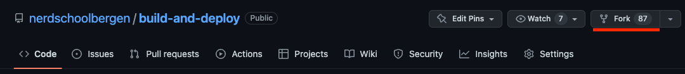
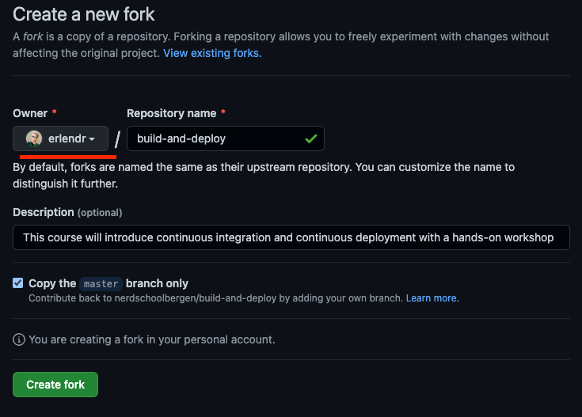
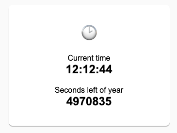

# Exercise 1 - Getting Started

In this exercise you will set up the local development environment required for the next exercises.

You will learn to:

* Install required software
* _Fork_ and _clone_ our Git repository and get it running on your computer.
* Get the local development environment up and running
* Take a quick tour of the repository and the app (even though the app is _not_ the focus of this workshop - deploying it is).

## 1.1 Installing required software

### 1.1.1 Node.js

:book: To see if you already have Node.js installed, open up your terminal application.

* If you're on a Mac, look for a command prompt application called "Terminal".
* If you're on a Windows machine, open Windows Terminal or "Git Bash".

:book: Once you've opened your terminal application, type `node -v`. The output will either tell you which version of Node.js is installed, or it will alert you that Node.js is an unknown command.

:pencil2: If it's an unknown command, download and install the latest LTS (long-term support) release from [nodejs.org](https://nodejs.org/en/download). This workshop requires **Node.js 26 or newer**.

:exclamation: **Note:** If you have Node.js installed with a version _less_ than 26, please upgrade to the latest LTS version before continuing.

### 1.1.2 Installing Chrome

:pencil2: Install [Google Chrome](https://www.google.com/chrome/) if you don't have it.

### 1.1.3 Visual Studio Code and YAML extension

:pencil2: Install [Visual Studio Code](https://code.visualstudio.com/).

:pencil2: Install the [Red Hat YAML extension](https://marketplace.visualstudio.com/items?itemName=redhat.vscode-yaml) for Visual Studio Code.

### 1.1.4 Installing Git

:book: Git is a command line tool for version control. It is used to manage and track changes in code.

:pencil2: To see if you already have Git installed, type `git version` in your terminal. The output will either tell you which version of Git is installed, or it will alert you that git is an unknown command. If it's an unknown command, follow the [Install Git](https://github.com/git-guides/install-git) guide.

#### Optional - Install GitHub Desktop

:bulb: If you are new to git, [GitHub Desktop](https://desktop.github.com/) is recommended to simplify working with git. GitHub Desktop also installs git automatically.

## 1.2 Accounts

### 1.2.1 GitHub account

:pencil2: If you don't already have a GitHub account, follow the [Sign up for a new GitHub account](https://docs.github.com/en/get-started/start-your-journey/creating-an-account-on-github) guide on GitHub.com. It's free!

:pencil2: Make a note of your GitHub _username_.

### 1.2.2 Netlify account

:book: We'll host the app on [Netlify](https://www.netlify.com/), a cloud platform with a free plan that doesn't require a credit card.

:pencil2: Sign up for a free account at [app.netlify.com/signup](https://app.netlify.com/signup). Choosing _Sign up with GitHub_ is the quickest option.

:pencil2: When Netlify asks _What is the name of your team?_, enter your own name or your GitHub username.

:book: On Netlify, every project belongs to a _team_. Companies use teams to share projects and billing between colleagues. For this workshop your team is just you, and the free plan is all we need.

:pencil2: Next, Netlify asks you to _Deploy your first project_. Select **Skip this step for now** at the top of the page.

> :exclamation: Don't choose _Import a Git repository_. Netlify would then build and deploy the app by itself, and we want to build that pipeline ourselves with GitHub Actions. We'll create the Netlify project in exercise 3.

## 1.3 Getting the code

:bulb: The exercises assume that you have some prior experience using git. If you are new to git, consider reading the following guides before continuing:

* Git overview: [About Git](https://docs.github.com/en/get-started/using-git/about-git) on GitHub Docs
* [Push commits to a remote](https://docs.github.com/en/get-started/using-git/pushing-commits-to-a-remote-repository) on GitHub Docs
* [Get changes from a remote](https://docs.github.com/en/get-started/using-git/getting-changes-from-a-remote-repository) on GitHub Docs

:book: Feel free to always ask the instructors for help, as git can be overwhelming for beginners.

### 1.3.1 Forking the git repository

:book: A fork is a copy of a repository. Forking a repository allows you to freely experiment with changes without affecting the original project.

:pencil2: Open the [nerdschoolbergen/build-and-deploy](https://github.com/nerdschoolbergen/build-and-deploy) repository page and select _Fork_:


:pencil2: Set _your_ GitHub user as _owner_ and then select _Create fork_:


:book: After forking, you should now have a copy of the repository on _your_ GitHub account.

### 1.3.2 Enabling GitHub Actions on your fork

:book: GitHub turns off workflows on new forks, so a fork can't run automation you haven't looked at. We'll use GitHub Actions in the next exercises, so let's turn it on now.

:pencil2: On your fork's page on GitHub, select the _Actions_ tab.

:pencil2: Select _I understand my workflows, go ahead and enable them_.

### 1.3.3 Cloning the git repository

:book: Repositories on GitHub are remote repositories. To create a local copy on your computer, you _clone_ the remote repository you just created on your account.

:pencil2: **Using GitHub Desktop:** follow [these instructions](https://docs.github.com/en/repositories/creating-and-managing-repositories/cloning-a-repository?tool=desktop).

:pencil2: **Using a web browser and a terminal:** follow [these instructions](https://docs.github.com/en/repositories/creating-and-managing-repositories/cloning-a-repository?tool=webui).

:exclamation: Make sure you clone _your fork_ (`https://github.com/<your-username>/build-and-deploy`), not the original nerdschoolbergen repository.

## 1.4 Setting up the local app development environment

:book: To make things easier, we have provided a simple example web app for you.

:pencil2: Navigate to the `code` directory in the repository in your terminal and run the following command to install all project dependencies:

```bash
npm install
```

:pencil2: Once everything is installed, open the repository directory in Visual Studio Code.

:book: Let's take a look at the structure of the `code` directory:

```text
code
├── index.html
├── package-lock.json
├── package.json
├── public
└── src
```

* `index.html` is the main entrypoint of the app
* The `package-lock.json` file is for npm to keep track of the exact versions of our dependencies.
* The `package.json` file is where we keep some metadata about our app, some _scripts_ like building the app and running tests, and a list of our dependencies.
* `public` - static files that are copied as-is into the built app (like the favicon)
* `src` - contains the web app JavaScript code

:pencil2: Run `npm start` in your terminal.

:book: The following output should appear:

```bash
  VITE v8.3.7  ready in 92 ms

  ➜  Local:   http://localhost:5173/
  ➜  Network: use --host to expose
```

:pencil2: Open [http://localhost:5173](http://localhost:5173) in Chrome.

## :book: 1.5 The app

Today is about deploying the app and not how it works or building more features, but it's worth having a quick tour nonetheless.

As the name implies, the app simply displays the current time and number of seconds left of the year:



### [Go to exercise 2 :arrow_right:](../exercise-2/README.md)
