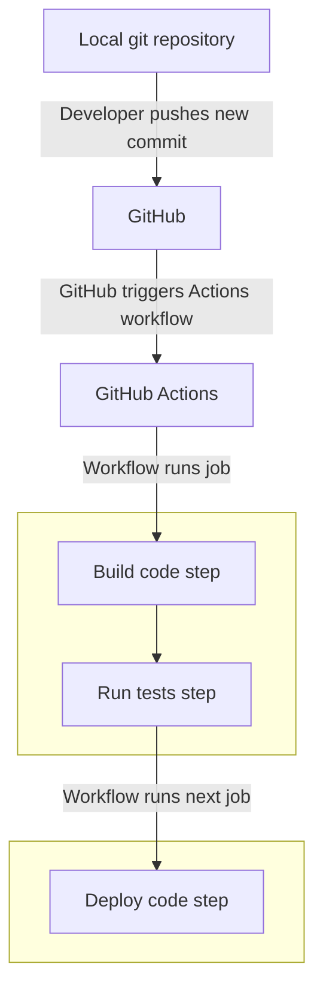
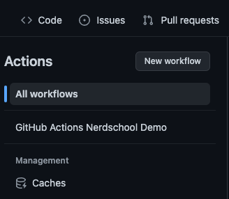
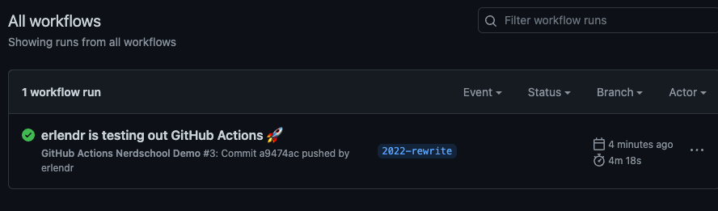
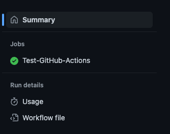
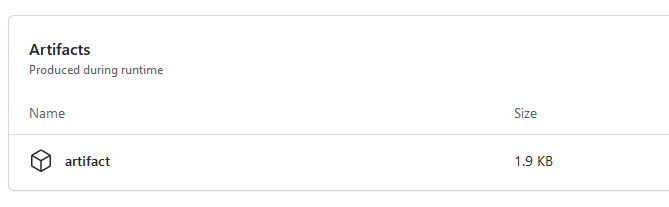

# Exercise 2 - CI/CD pipeline setup

In this exercise you will learn how to set up a CI/CD pipeline for automating tasks using a service called GitHub Actions.

You will learn:

- The basics of GitHub Actions
- Setting up a pipeline
- Automating building the code
- Automating code quality control
- Automating running unit tests
- Creating a build artifact that can be deployed later

## 2.1 GitHub Actions

:book: Instead of setting up a build server from scratch, we'll use GitHub Actions to do all the heavy lifting for us.

:book: GitHub Actions is a service for handling our Continuous Integration steps. We will use another service for hosting our app once we've built and verified it using GitHub Actions.

Here is an overview of how a CI/CD pipeline created using GitHub Actions works:



## 2.2 GitHub Actions config

:book: GitHub Actions is "configuration as code", which means that you configure it by simply adding a workflow configuration file to your repository.

:pencil2: Create a new folder at the root of the repository called `.github`

:pencil2: Inside `.github`, create a new folder called `workflows`.

:book: The folder structure should look like this:

```shell
.github
└── workflows
```

### 2.2.1 GitHub Actions Hello World

:book: Before we start doing anything useful with GitHub Actions, we need to get familiar with the basics of how it works.

:pencil2: Inside the `workflows` folder, create a new file named `test.yml` with the following contents:

```yml
name: GitHub Actions Nerdschool Demo
run-name: ${{ github.actor }} is testing out GitHub Actions 🚀
on: [push]
jobs:
  Test-GitHub-Actions:
    runs-on: ubuntu-latest
    steps:
      - run: echo "🎉 The job was automatically triggered by a ${{ github.event_name }} event."
      - run: echo "🐧 This job is now running on a ${{ runner.os }} server hosted by GitHub!"
      - run: echo "🔎 The name of your branch is ${{ github.ref }} and your repository is ${{ github.repository }}."
      - name: Check out repository code
        uses: actions/checkout@v7
      - run: echo "💡 The ${{ github.repository }} repository has been cloned to the runner."
      - run: echo "🖥️ The workflow is now ready to test your code on the runner."
      - name: List files in the repository
        run: |
          ls ${{ github.workspace }}
      - run: echo "🍏 This job's status is ${{ job.status }}."
```

:book: The folder structure should look like this:

```shell
.github
└── workflows
    └── test.yml
```

:pencil2: Save and git commit this file. Git push all your changes so far.

:book: Committing the workflow file in your repository and pushing it to GitHub triggers the `push` event and runs your workflow.

### 2.3 Viewing your workflow results

:pencil2: On GitHub.com, navigate to the main page of your repository.

:pencil2: Under your repository name, click "Actions".


:pencil2: In the left sidebar, click the workflow you want to see (we named it `GitHub Actions Nerdschool Demo`).



:pencil2: From the list of workflow runs, click the name of the run you want to see (`'xxx' is testing out GitHub Actions 🚀`)



:pencil2: Under **Jobs**, click the Test-GitHub-Actions job.



:book: The log shows you how each of the steps was processed. Expand any of the steps to view its details.

:book: The example workflow you just added is triggered each time code is pushed to the branch, and shows you how GitHub Actions can work with the contents of your repository.

:book: Next step is to make GitHub Actions do something more useful!

:exclamation: If you are not able to see the workflow, try refreshing the page. If the Actions tab says workflows are disabled, enable them (see exercise 1).

### 2.4 Workflow for building our app

:book: The most important step in a CI pipeline is the _build_ step, where code is built to see if a new commit pushed _breaks the build_ or not.

:book: We are going to use the following commands inside our new pipeline to build our app:

```bash
npm ci
npm run build
```

- :book: `npm ci` installs all project dependencies. This command is similar to `npm install`, except it's meant to be used in automated environments: it installs exactly the versions listed in `package-lock.json`.
- :book: `npm run build` creates a `dist` (abbreviation for "distribution") directory with a production build of your app.

:bulb: These commands are specific to the app we are building. If you need to build another type of app (Python, .NET, Java, etc.) in your pipeline, you need to use different build tools and commands.

:pencil2: Delete the file `test.yml` we previously created from the `.github/workflows` folder.

:pencil2: Create a new file called `main.yml` in the `.github/workflows` folder with the following contents:

```yml
name: Build and deploy

on:
  push:
    branches: [master]
  pull_request:

jobs:
  build:
    runs-on: ubuntu-latest
    defaults:
      run:
        working-directory: ./code
    steps:
      - uses: actions/checkout@v7
      - name: Use Node.js 26.x
        uses: actions/setup-node@v7
        with:
          node-version: 26.x
      - run: npm ci
      - run: npm run build
```

Let's break down what this workflow does:

- `name:` - the name of the workflow
- `on:` - which events _trigger_ the workflow:
  - `push: branches: [master]` - when commits are _pushed_ to the `master` branch
  - `pull_request:` - when a _pull request_ is opened or updated. We'll use this in exercise 4.
- `jobs:` - what jobs we want the workflow to do
  - `build:` - the name of our job
    - `runs-on: ubuntu-latest` - we want to run our workflow on Linux (latest release of Ubuntu)
    - `defaults:` default settings for the job
      - `run:` - settings for running commands
        - `working-directory: ./code` - set working directory for running commands to `./code`, where our app is located
    - `steps:`
      - `- uses: actions/checkout@v7` - git clone the repository
      - Install Node.js:

      ```yml
        - name: Use Node.js 26.x
          uses: actions/setup-node@v7
          with:
            node-version: 26.x
      ```

      - `- run: npm ci` - install dependencies
      - `- run: npm run build` - build app

:bulb: Why not just `on: [push]`? Then a pull request would run the workflow twice: once for the push to the branch and once for the pull request. Teams commonly only run on pushes to the main branch plus on pull requests.

:pencil2: Commit all changes and push them to GitHub. The new workflow will now trigger.

:pencil2: Open the GitHub Actions workflow overview and click on the new `Build and deploy` workflow on the left side. Click on the workflow run on the right side to see more details.

:book: A workflow run will either succeed or fail, depending on if any of the job steps fail.

:pencil2: Did the workflow run fail :x:? Try reading the error message and figure out what's wrong. Ask an instructor if you are stuck.

## 2.5 Improving Continuous Integration

:book: Remember that Continuous Integration is all about making sure our code is good enough to be deployed. So far we're not doing much to prove this. We make sure the app can be built, but that's about it. Let's introduce some more quality checks.

### 2.5.1 Linting

:book: Linting means verifying that our code follows certain best practices and code conventions. We use the tool _[Oxlint](https://oxc.rs/docs/guide/usage/linter)_ to do this for us. Oxlint statically analyzes your code to quickly find problems. It understands the same rules as [ESLint](https://eslint.org/), the most widely used JavaScript linter, but is a lot faster.

:book: Oxlint is configured in `code/.oxlintrc.json`. We tell it that our code runs in a browser, that every rule in the _correctness_ category is an error, and which folders to skip:

```json
{
  "$schema": "./node_modules/oxlint/configuration_schema.json",
  "env": {
    "browser": true
  },
  "categories": {
    "correctness": "error"
  },
  "ignorePatterns": ["node_modules", "dist", "coverage"]
}
```

:bulb: Linters separate _warnings_ from _errors_. Only errors make `npm run lint` fail, so only errors stop our pipeline. By making the correctness rules errors, we make sure code with real problems never gets deployed.

:pencil2: In a terminal window, cd into the `code` folder and run `npm run lint` to run Oxlint. The command should finish in a moment, without errors.

:pencil2: Open `code/src/main.js` and add the following line to the end of the file:

```javascript
const unusedVariable = 3;
```

:pencil2: Save the file, commit the change and run `npm run lint` again. You should see the following error on the screen:

```shell
> nerdschool-build-and-deploy@0.0.0 lint
> oxlint

  × eslint(no-unused-vars): Variable 'unusedVariable' is declared but never used. Unused variables should start with a '_'.
    ╭─[src/main.js:14:7]
 13 │ setInterval(render, 1000);
 14 │ const unusedVariable = 3;
    ·       ───────┬──────
    ·              ╰── 'unusedVariable' is declared here
    ╰────
  help: Consider removing this declaration.

Found 0 warnings and 1 error.
```

:book: This is one of the quality checks we get with linting. We have a variable that is not used anywhere and does not provide any value, so the linter tells us that the code is not up to the required standards.
This is an example of linting helping us enforce good coding practices.

:bulb: Most code editors have plugins for linters, so you get warnings and errors inline while you type, which is very helpful. For Visual Studio Code, install the [Oxc extension](https://marketplace.visualstudio.com/items?itemName=oxc.oxc-vscode).

:pencil2: To make our CI pipeline automatically lint code, add the following line to `.github/workflows/main.yml`:

```diff
name: Build and deploy

on:
  push:
    branches: [master]
  pull_request:

jobs:
  build:
    runs-on: ubuntu-latest
    defaults:
      run:
        working-directory: ./code
    steps:
      - uses: actions/checkout@v7
      - name: Use Node.js 26.x
        uses: actions/setup-node@v7
        with:
          node-version: 26.x
      - run: npm ci
      - run: npm run build
+     - run: npm run lint
```

:pencil2: Git commit this change and push. View the result in the Actions workflow jobs overview on GitHub.com.

:book: The build should fail at this point, because it did not pass our linting step.

:pencil2: Remove the unused variable that we introduced, and run `npm run lint` again in your terminal to ensure that the code is linted successfully. Push the change to GitHub and see that the build is successful.

### 2.5.2 Testing

:book: There is already a script for running our unit tests in `package.json`.

:pencil2: Run `npm test` and see that all tests pass.

:pencil2: To run tests automatically in our CI pipeline, add the following line to `.github/workflows/main.yml`:

```diff
name: Build and deploy

on:
  push:
    branches: [master]
  pull_request:

jobs:
  build:
    runs-on: ubuntu-latest
    defaults:
      run:
        working-directory: ./code
    steps:
      - uses: actions/checkout@v7
      - name: Use Node.js 26.x
        uses: actions/setup-node@v7
        with:
          node-version: 26.x
      - run: npm ci
      - run: npm run build
      - run: npm run lint
+     - run: npm test
```

:pencil2: Git commit this change and push. View the result in the Actions workflow jobs overview on GitHub.com.

:star: Bonus task: Try messing around with the tests in `code/src/clock.test.js`. Can you make them fail? Or even create new tests that are run in our CI pipeline?

## 2.6 Creating a build artifact

:book: Before we can start deploying anything to the internet, we need something to deploy. So far, we have checked that our code builds and that it passes our quality control checks through linting and testing.

:book: To get an _artifact_ (a fancy word for the built output of our application), we take the output of our build step and store it as a file attached to the GitHub Actions workflow run. A real-life pipeline builds the artifact _once_, and then deploys that exact same artifact. That way, what you tested is what you ship.

:book: `npm run build` produces a folder called `dist` on the GitHub Actions runner. We can upload that folder to our workflow run, and download it again in later jobs when we are going to deploy the application.

:pencil2: Modify your workflow file to include the `Archive artifacts` step as shown below.

```diff
name: Build and deploy

on:
  push:
    branches: [master]
  pull_request:

jobs:
  build:
    runs-on: ubuntu-latest
    defaults:
      run:
        working-directory: ./code
    steps:
      - uses: actions/checkout@v7
      - name: Use Node.js 26.x
        uses: actions/setup-node@v7
        with:
          node-version: 26.x
      - run: npm ci
      - run: npm run build
      - run: npm run lint
      - run: npm test

+     - name: Archive artifacts
+       uses: actions/upload-artifact@v7
+       with:
+         name: artifact
+         path: ./code/dist
```

:bulb: `working-directory` only applies to `run:` steps, not to actions used with `uses:`. That's why `path` includes `./code`.

:pencil2: Commit and push your change to GitHub. You should see the artifact at the bottom of your workflow run page. This is our application that has been built and is ready to be deployed.

 

___

Well done so far :tada:! Next, we'll deploy the app.

### [Go to exercise 3 :arrow_right:](../exercise-3/README.md)
